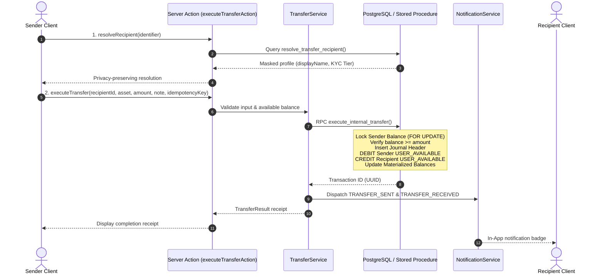

# Internal User-to-User Transfer Specification

## 1. Overview & Architectural Principle
ApexWallet provides instant, zero-fee internal peer-to-peer (P2P) transfers between eligible registered users. In accordance with the system's authoritative financial architecture, internal transfers are never executed through client-side state mutation. The entire financial movement is authorized and committed atomically on the server via PostgreSQL row-level locks and double-entry ledger bookkeeping.

---

## 2. End-to-End Workflow



---

## 3. Privacy-Conscious Recipient Discovery
To protect user privacy and prevent harvesting of Personally Identifiable Information (PII):
- Discovery supports verified email address, registered phone number, or account UUID.
- Lookups are executed via the `SECURITY DEFINER` function `resolve_transfer_recipient(p_identifier)`.
- The returned response strictly masks contact details:
  - Email: `mu***@example.com`
  - Phone: `+234***678`
  - Display Name: `First Name` + abbreviated last name initial (e.g. `Musa A.`)
  - Verification: Tier KYC Level badge
- Never exposes user wallet balances, residential addresses, or account numbers.

---

## 4. Invariants & Financial Controls

| Control | Mechanism | Failure Behavior |
| :--- | :--- | :--- |
| **Self-Transfer Prohibition** | Server-side validation (`p_sender_id = p_recipient_id`) | Raises `ERR_SELF_TRANSFER_PROHIBITED` (HTTP 400) |
| **Available Balance Enforcement** | Exclusive row lock (`FOR UPDATE`) on `wallet_balances` | Raises `ERR_INSUFFICIENT_FUNDS` (HTTP 400) |
| **Atomic Balance Conservation** | Strict debit/credit equality (`amount_debit = amount_credit`) | Database transaction aborts with zero balance change |
| **Duplicate Click Protection** | Deterministic `idempotency_key` unique constraint | Replays existing transaction ID without re-debiting |
| **Zero Fee Policy** | System platform fee configured to 0.00 | Total debit matches exact transfer amount |

---

## 5. Double-Entry Accounting Representation

For a transfer of **50.00 USDT** from User A to User B:

```
Journal Transaction: INTERNAL_TRANSFER (Ref: TRF-8B29FA1C)
├── DEBIT  User A [USER_AVAILABLE]      50.00 USDT (Liability Decreases)
└── CREDIT User B [USER_AVAILABLE]      50.00 USDT (Liability Increases)
Sum of Debits: 50.00 USDT | Sum of Credits: 50.00 USDT (Delta = 0.00)
```

System clearing accounts are not touched during internal transfers because the platform's aggregate custodial liability remains unchanged.
