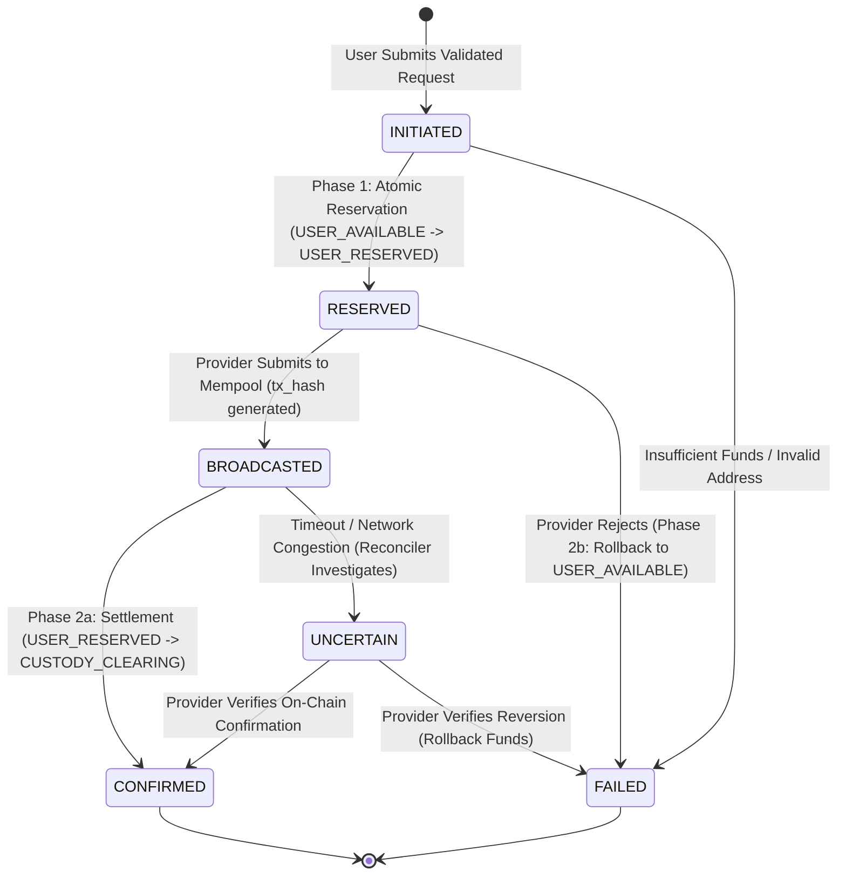

# External Crypto Withdrawal Workflow Specification

## 1. Overview
ApexWallet enables users to withdraw supported crypto assets (USDT, USDC, BTC, ETH, SOL) to external on-chain addresses across supported blockchain networks (Polygon, Arbitrum, Base, Ethereum, Tron, Solana). 

Outbound withdrawals follow a strict **Two-Phase Reservation & Settlement** architecture to guarantee that funds are never debited prematurely, lost in transmission, or duplicated during custodial API retries.

---

## 2. Two-Phase Execution Lifecycle

---

## 3. Phase-by-Phase Technical Details

### Phase 1: Fund Reservation (Pre-Submission Lock)
Before any network call is dispatched to the MPC custodial provider (Fireblocks):
1. **Address Validation:** Destination address is validated against network-specific standards:
   - EVM (Polygon, Arbitrum, Base, Ethereum): Regex `^0x[a-fA-F0-9]{40}$`
   - Tron (TRC-20): Base58Check with leading `T` and 34 characters
   - Solana: Base58 string between 32 and 44 characters
   - Bitcoin: Native SegWit (Bech32 `bc1...`) or legacy formats
2. **Fee Estimation:** Live network gas estimate is calculated using `FireblocksCustodyAdapter.estimateNetworkFee(asset, network)`.
3. **Reservation Stored Procedure (`reserve_withdrawal_funds`):**
   - Locks sender balance row (`FOR UPDATE`).
   - Verifies `available_balance >= (amount + network_fee)`.
   - Dispatches journal entries:
     - `DEBIT  USER_AVAILABLE` (total debit)
     - `CREDIT USER_RESERVED` (total debit)
   - Status transitions to `RESERVED`.

### Phase 2a: Final Settlement (Upon Successful Broadcast)
When the custodial provider broadcasts the transaction to the blockchain:
1. `submitWithdrawal` returns `providerTxId` and `txHash`.
2. Stored procedure `settle_withdrawal_funds` executes:
   - `DEBIT  USER_RESERVED` (total debit)
   - `CREDIT CUSTODY_CLEARING` (net on-chain amount)
   - `CREDIT FEE_REVENUE` (platform / gas fee)
3. Status transitions to `CONFIRMED`.
4. In-app notification `WITHDRAWAL_CONFIRMED` is dispatched with external explorer link.

### Phase 2b: Compensating Rollback (Upon Custodial Rejection)
If the custodial provider rejects the operation (e.g. invalid gas limit, internal policy rejection):
1. Stored procedure `rollback_withdrawal_funds` executes immediately:
   - `DEBIT  USER_RESERVED` (total debit)
   - `CREDIT USER_AVAILABLE` (total debit)
2. Status transitions to `FAILED` with `error_reason`.
3. In-app notification `WITHDRAWAL_FAILED` alerts the user that funds were restored to their available balance.

---

## 4. Provider Sandbox Fallback
In non-production environments where live Fireblocks API signing keys are absent:
- Outbound withdrawals execute against a deterministic transparent sandbox.
- Receipts are explicitly badged: `Transparent Sandbox Execution: Testnet simulation broadcasted without monetary debit.`
- Transaction hashes are deterministically generated via SHA-256 for audit and test verification.
